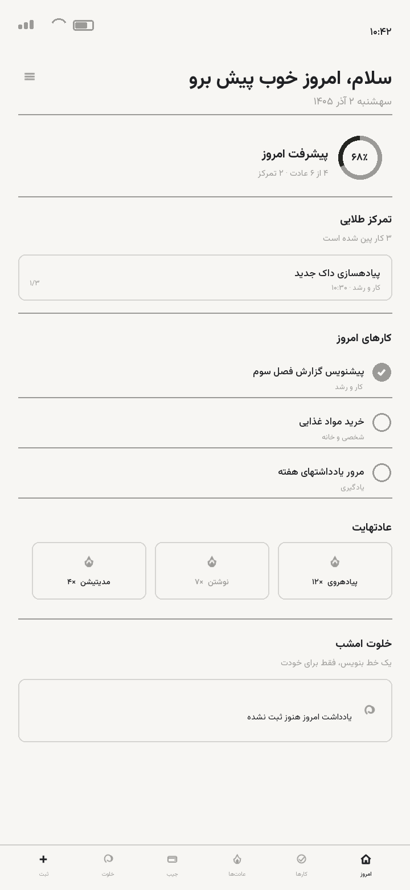
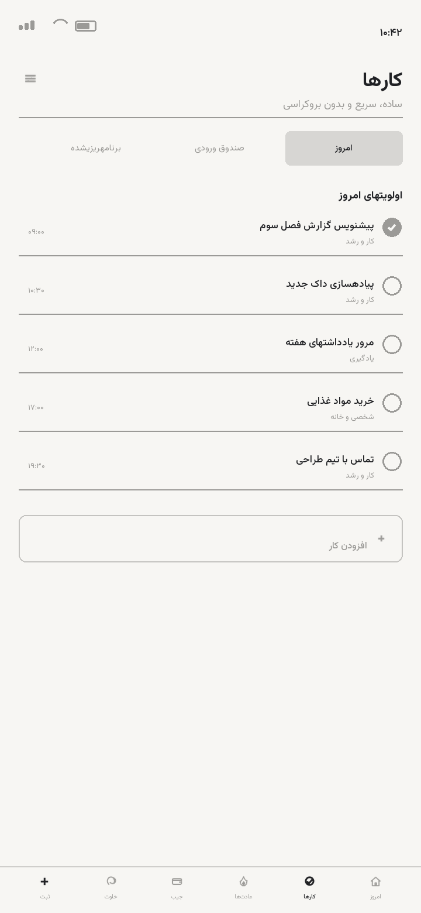
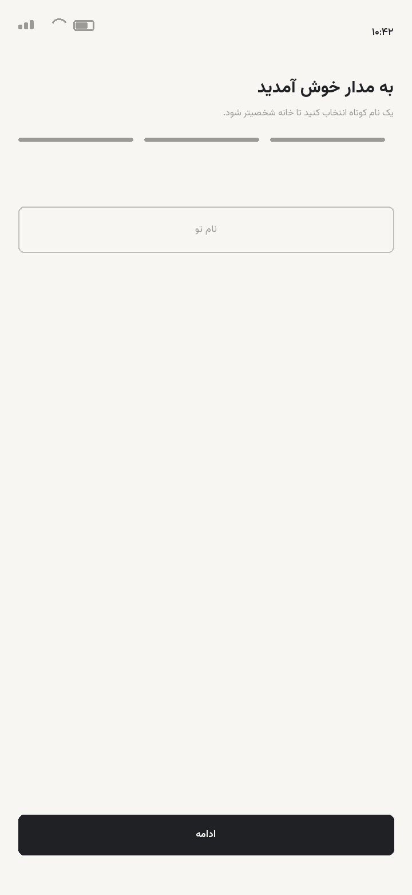

# مدار — بازطراحی به سبک Notion / Obsidian

پیشنمایشهای مسطح و تخت (اسکرینشات زنده نیستند).

| صفحه | فایل |
|---|---|
| نمای کلی | `design-board.png` |
| امروز (روشن / تاریک) | `design-today.png` / `design-today-dark.png` |
| کارها | `design-tasks.png` |
| عادت‌ها | `design-habits.png` |
| جیب | `design-finance.png` |
| خلوت | `design-journal.png` |
| آنبوردینگ (مرحله نام) | `design-onboarding.png` |

